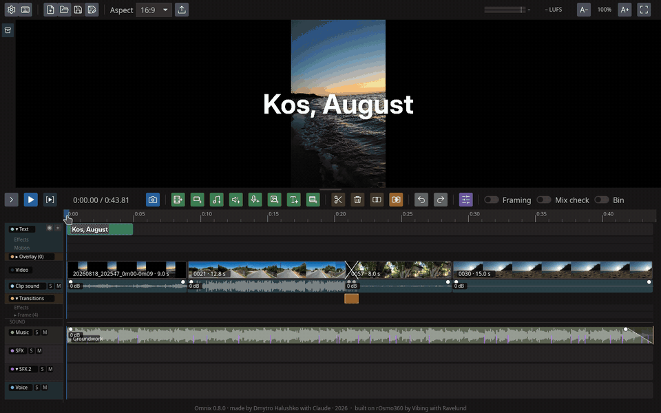

# Omnix

**Omnix** is a home-video editor for Linux, written in Rust. It exists because its author wanted to edit his trips on Linux from start to finish: footage from a phone, an action camera, a drone and a 360 camera, with the sound treated as carefully as the picture. No editor did that, and the makers of 360 cameras don't make their software for Linux either. It began as editing for 360 footage, forked from [rOsmo360](https://github.com/ravelund/rOsmo360) by Vibing with Ravelund, which plays DJI Osmo 360 `.OSV` files directly: it stitches the two lenses, stabilises with the camera's gyro and lets you look around freely. Since the fork the work has gone into the editing itself: the timeline, sound lanes and loudness, the bin, cutting to the beat, transitions, speed, and an operations core that a script or an AI can drive. The 360 side is still rOsmo360's, as it was at the fork. One rule sets the order: an idea is carried to at least 95 % before the next big one starts.



**New here? Read [the guide](docs/guide/README.md)**: installing, a tutorial from a trip's clips to a finished film, how it fits together, and every key, command and setting. (`mdbook serve docs/guide` shows it as a book.)

Its sibling, **[Dailix](https://github.com/nedcrest/dailix)**, is the contact sheet before the edit: it looks through a trip's footage, marks what's worth keeping and hands the chosen material to Omnix. The contact sheet's core, which both programs read and write, lives here (`crates/sheet`).

**Built with AI.** Dailix, and everything Omnix added to rOsmo360 since the fork, were built by one person working with Claude: he decided, designed and tested on his own footage; Claude planned, wrote the code, tests and docs, and audited its own work. How that worked, and the rules that kept the code sound as it grew from 19,000 to 50,000 lines in three weeks: **[docs/AI-DRIVEN.md](docs/AI-DRIVEN.md)**.

Licensed under [MIT](LICENSE-MIT) or [Apache-2.0](LICENSE-APACHE), at your option.

Omnix has no published releases yet: build it from source; see [Building](#building). The packaging scripts (`packaging/`) make the same archives, AppImage, Flatpak and Windows zip as upstream's, under Omnix's name.

## Where it comes from

Omnix is a fork of [rOsmo360](https://github.com/ravelund/rOsmo360) 0.7.1 by Vibing with Ravelund (Ole Morten Aaslund), MIT OR Apache-2.0, itself built with Claude. rOsmo360 wrote the 360 heart of it and a full editor around it: stitching with DJI's calibration and seam alignment, gyro stabilisation and rolling-shutter correction, the GPU player and exporter, keyframed views, a timeline with music, crossfades, colour effects, LUTs and D-Log M, titles and overlays, ordinary videos and photos, and the Mac and Windows builds: about 19,000 lines. From 2026-10-22 its author, working with Claude, turned it into a home-video editor: an operations core that scripts and AI agents can drive, groups and sync lock, cutting on the beat, transition and automation lanes, speed, sound lanes with cleaned voices and loudness control, the bin and project cards, and Dailix, the contact sheet before the edit. [Features](#features) says which side each comes from; [CHANGELOG.md](CHANGELOG.md) lists everything Omnix added.

## Features

First what Omnix added since the fork, then what it took over from rOsmo360 0.7.1.

### Added in Omnix

- **Operations core**: every change to a project is a checked, undoable operation, open to the command line and to an AI agent (`omnix apply`, `omnix describe`, `omnix ops-schema`, `omnix looks`).
- **Selections and groups**: several cuts at once; groups that move together; **sync lock**, so sound, titles and pictures follow the picture they lie under.
- **Copy and paste** cuts: at the playhead, splitting the cut there, or at the nearest join.
- **Speed**: a cut slowed down or sped up from ¼× to 4×, its sound with it, keeping its pitch or like tape; or a **speed curve** in a window of its own, easing from one speed to another, over one cut or several side by side ([how](docs/guide/speed.md)).
- **Cuts on the beat**: a song's beats found and snapped to.
- **Markers**, a blank stretch, inserting between cuts, a stretch played from the ruler, the playhead moved by keys in sensible steps.
- **Transitions**: a transitions lane and templates, edge looks (fade, blur, zoom, glitch, flash), each look's own settings.
- **Automation lanes**: effects, view, frame and overlay values as curves with keys, each clip on its own scale.
- **Framing an ordinary video**: a base frame and Frame lanes with keys and curves.
- **Sound lanes**: music, two for effects, voice; each clip with its own volume line, fades and level; waveforms drawn as heard.
- **Voice**: a cleaned voice in place of a clip's sound; a voice-over recorded inside Omnix.
- **Loudness**: speech brought to −16 LUFS, normalize and even out, ducking under talk, a true-peak limit on export, a mix check against a platform's levels.
- **More picture**: black and white levels, vignette shapes, glow and blur, cinematic bars, auto colour, styles (old film, VHS, cyberpunk), scopes; text and picture lanes in groups, animations in and out, picture kinds (sticker, polaroid, picture-in-picture).
- **The bin** as a view of its own, quick copies of ordinary videos for smooth playback, and **Dailix**, the contact sheet before the edit.
- **Project cards**: the start screen's edits as mosaics of their own frames.

### From rOsmo360

As rOsmo360 0.7.1 had them at the fork; the 360 side is unchanged since. Its numbers are rOsmo360's own, measured on its author's machine.

#### Playing

- **Stitching** with DJI's own calibration, read from each clip, keeping each lens's colours as the camera recorded them. Per frame it also:
  - shifts the lenses to line up close subjects, such as the hand on a selfie stick, so they don't ghost;
  - cuts cleanly to one lens where the two see different things (a fist in front of the sky), and blends everywhere else, so sun glare in one lens doesn't draw a line across the landscape;
  - fades each lens out smoothly where DJI's masks hide the selfie stick, so glare leaves no line in the sky.
- **Stabilisation** from the camera's built-in 1 kHz motion data, with rolling-shutter correction:
  - **Horizon**: a level horizon that follows where you point the camera.
  - **Level**: a level horizon that stays pointing one way in the world while the camera turns.
  - **World lock**: the view stays fixed in the world, tilt included.
- **Free look**: drag to look around, scroll to zoom, and roll the view, or type the view's yaw, pitch, roll and field of view (or drag their names) to frame shots exactly alike.
- **Projections**: little planet (the default, like DJI Studio), perspective and flat equirectangular, and a **correction** that bends perspective any way towards the little planet, for wide shots.
- **Every video mode** of the Osmo 360, 100 fps included.
- **Smooth playback** from the low-resolution proxy (`.LRF`), switching to the full-resolution frame when paused. On a fast GPU, or an Apple Silicon Mac, it can stream the full-resolution `.OSV` directly.
- **Hardware decoding** on any GPU vendor: Vulkan Video, VA-API or CUDA on Linux, VideoToolbox on a Mac, with a software fallback.
- **10-bit decoding** (a setting) keeps the Osmo's full 10 bits, for smoother skies and room to grade.
- **D-Log M** recognised from the clip itself (DJI tags it as ordinary BT.709) and turned into normal colours with DJI's LUT, added once to a **LUT library**; any `.cube` LUT works, per cut.
- **Sound**, in sync with the picture, with mute and volume in an Audio panel, and an **audio meter** of the mix (peak and RMS per channel, red past 0 dBFS, the loudest peak held), as the export will mix it.
- **Save photos** of a paused frame: the view as framed, at 3840 px on the long side, or the whole 360° sphere at 7680 × 3840.
- **Aspect lock** (16:9, 9:16, 4:3, 1:1, 2:1) for framing shots; saved views and exports take the same shape.
- **Panels** that open beside the view as you need them: effects, export, audio, settings, a title's text, and file information (right-click anything on the timeline).
- **Themes**: the dark Kanagawa Dragon by default, or any of iced's light and dark themes. Your settings are remembered between runs.

#### Editing

- **Timeline** of cuts from one or more clips: split, trim, move and delete them, with undo and redo. Each cut shows thumbnails of its footage, its keyframes sit in rows under it, and the timeline zooms in for fine work. Drag the bar above it to give it, or the picture, more room.
- **Ordinary videos and photos** as cuts beside the Osmo clips: MP4, MOV and the like from a phone, a drone or an action camera (any frame rate, portrait too, and a phone's HDR, brought to normal colours by itself), and JPG, PNG, WebP and other pictures. They work like any cut, framed by pan and zoom keyframes, so a slow push-in over a photo comes free.
- **Keyframes** for the view: where it looks (yaw, pitch, roll), the zoom, and the projection with its correction, so a shot can pan, zoom or morph into a little planet. Each keyframe eases into the next smoothly, at a steady speed, or holds and then cuts. With Auto keyframe on, framing the view while paused keys it by itself. Every kind of keyframe mark drags along the timeline to retime it.
- **Follow the stick**: a keyframe can follow the selfie stick, and so whoever holds it, for a third-person shot that frames you automatically. It works from the camera's motion data, even straight below the camera.
- **Follow a subject by colour**: `omnix track` finds a coloured subject (a friend's jacket, a tent) through a clip, and keyframes can follow it the same way.
- **Stabilisation per cut**: one cut world-locked, the next following the horizon.
- **Crossfades** between cuts, picture and sound: overlap two cuts and the first dissolves into the second. Select a cut in the overlap to frame it on its own.
- **Music**: songs on a lane of their own under the edit, to move, trim, split and crossfade; it fades out by itself where the video ends. A project can start from a song.
- **Sound levels**: one slider for the clips' sound and one for the music, plus volume points over time on the music and on each cut's own sound, to dip the music under talk or tame the wind.
- **Colour effects**, keyframed per cut: exposure (brightening rolls highlights off instead of burning them out), contrast, highlights and shadows, temperature and tint (with a white-balance eyedropper), saturation, vibrance, a vignette and opacity, in a side panel, after the cut's LUT and its strength (keyframed too, so a LUT can fade in). Plus fades from and to black for the whole edit.
- **Titles and overlays**: a text track and an overlay track above the picture, for titles, captions and logos (PNGs keep their transparency). Text is typed in a panel of its own, with six built-in fonts that look the same on every computer (and your system's), size, colour, alignment, a shadow and an outline. Drag, size and turn items right on the view; their place, effects and opacity are keyframed, so a title can drift and fade.
- **Projects**: save the edit and open it again later, framed as you left it. A cut can carry a short note, shown on the timeline.
- **Export** the edit to MP4 with its sound, from 720p to 4K, in the aspect lock's shape, dithered so skies don't band. It renders on the GPU, about four times faster than the CPU (21 frames a second at 1080p on an RTX 3090).
- **Export for another editor**: a file per cut (`My hike - 001.mp4`, `- 002` …) with the music beside them as WAVs, graded or as shot (D-Log M left in log), and a DaVinci Resolve format (10-bit DNxHR HQX with PCM sound in `.mov`) that Resolve's free Linux version can read.

#### Command line

- **Export** a clip with a fixed view or keyframed camera moves, or a whole project, in any shape such as 9:16.
- **Skim clips**: contact sheets of stitched frames (of a clip, or of a project: a row per cut headed with its edit time, the titles drawn in, the music's waveform underneath), and a per-second summary of the camera's motion and the sound level, for one clip or a whole folder.
- **Check an edit** for likely mistakes: cuts out of filming order, repeated footage, crossfades within one scene, pans too fast to follow, music that ends too soon.
- Stitch single frames or whole clips to equirectangular images and MP4 video.

## Requirements

- A DJI Osmo 360 clip (`.OSV`). Keep the `.LRF` proxy file next to it for the smoothest playback. Ordinary videos and photos can join it in an edit.
- `ffmpeg` and `ffprobe` on your `PATH` (the Flatpak and the Mac build bring their own).
- A GPU with Vulkan support (Linux) or an Apple Silicon Mac, with up-to-date drivers. It plays, decodes and exports.
- On Linux, ALSA for sound (`alsa-lib`, or `libasound2-dev` on Debian/Ubuntu). PipeWire and PulseAudio work through it.
- To build: Rust 1.88 or newer.

Omnix is developed and tested on Linux (KDE Plasma, NVIDIA RTX 3060). rOsmo360, which it grew from, was developed on Linux and an Apple Silicon Mac, with Windows in beta; Omnix keeps their build scripts, but hasn't been tested on the Mac or Windows since it forked.

## Installing

No releases yet: see [Building](#building). Once Omnix is published, `packaging/` makes an install script, an AppImage, a Flatpak and a Windows zip, as upstream's releases have them.

## Building

```sh
# Debian/Ubuntu: ALSA's headers to build, ffmpeg to run (and for the tests)
sudo apt install pkg-config libasound2-dev ffmpeg
cargo build --release
cargo test --workspace     # Omnix and the contact sheet's core
```

The program is `target/release/omnix`. CI (`.github/workflows/ci.yml`) does the same on Ubuntu 24.04, with Mesa's CPU Vulkan so the GPU tests run there too. `packaging/build-release.sh` builds the release files into `dist/`, inside an Ubuntu 22.04 container (docker), so they run on older distributions too.

On an **Apple Silicon Mac** (with [Rust](https://rustup.rs) and `xcode-select --install`), `sh packaging/macos/build.sh` builds it, fetches a static arm64 ffmpeg (GPL, with VideoToolbox) and makes `target/release/Omnix.app` to open from the Finder. There's no signed download for the Mac yet.

For **Windows**, `sh packaging/windows/build.sh` cross-builds on Linux (docker, MinGW): `omnix.exe` with its icon, beside an ffmpeg built from pinned sources (GPL, with Direct3D 11, NVDEC and Vulkan decoding), zipped as `target/windows/Omnix-x86_64-windows.zip`, with those sources in `Omnix-windows-ffmpeg-sources.tar`.

Want to help? See [CONTRIBUTING.md](CONTRIBUTING.md), and [AGENTS.md](AGENTS.md) if you work with an AI coding agent.

## Usage

[The guide](docs/guide/README.md) walks through it step by step, with pictures: the tutorial, then the reference ([keys](docs/guide/keys-omnix.md), [commands](docs/guide/commands-omnix.md), [settings and files](docs/guide/settings-and-files.md)). The command line in brief:

```sh
omnix play                 # opens the player; use Open clips… or Ctrl+O
omnix play clip.OSV        # opens a clip straight away
omnix play a.OSV b.OSV     # several clips, one after another on the timeline
omnix play edit.json       # a saved project
```

In the player:

| Action | How |
|---|---|
| Look around | Drag (right-drag or Q/E rolls) |
| Zoom | Scroll, or `+` / `-` |
| Play / pause | Space |
| Seek | Drag the seek bar, or ← / → for 5 s |
| Step one frame (paused) | `,` and `.` |
| Stabilisation (of the playing cut) / projection | S / P, or the pickers in the top bar |
| Rolling-shutter correction | R, or the Effects panel |
| Mute / volume | M / the speaker opens the Audio panel |
| Settings: theme, 10-bit decoding, Auto keyframe, the view angles row | The cog at the top left, or Ctrl+, |
| What a file is and where it lives | Right-click its cut, song or picture on the timeline: the Info panel, with show in folder and copy path |
| Reset view / fullscreen | 0 / F |
| Type the view | The row under the transport row: Yaw, Pitch, Roll, FOV and Correction (Enter sets one; drag a name sideways, scroll or ↑ / ↓ on a field to nudge it, Shift for finer); Settings can hide it |
| More room for the timeline or the picture | Drag the bar between the view and the transport row; double-click puts it back |
| Keyframe the current view | K, or the ◆+ button (on a keyframe, it updates it) |
| Jump to the previous / next keyframe | `[` / `]`, or click a ◆ in the cut's View row |
| Move / delete a keyframe | Drag its mark (view, effects or motion) / Delete |
| How a keyframe moves on to the next | J cycles, or the Ease picker: smooth (◆), linear (●) or hold (■, stays put then cuts) |
| Make a keyframe follow the selfie stick or a subject | The Follow picker: Fixed, Stick, or Colour track (its mark gets a ring); for a colour track, the eyedropper: drag a box over the subject (a jacket, a tent) and it's tracked to the end of the cut |
| Keep the horizon level and the heading fixed | S to **level**: a keyframe's yaw is then a direction in the world, so a view stays on a summit through a pan |
| Zoom the timeline | Scroll on it (around the pointer), Ctrl+= / Ctrl+−, or the 🔍 buttons and slider; Ctrl+0 or ⟷ shows the whole edit |
| Scroll the zoomed timeline | Shift+scroll or a sideways scroll on it, or drag the bar under it; it follows the playhead while playing |
| Add clips to the edit | The film strip with a plus (Ctrl+O); several at once is fine |
| Split the cut at the playhead | C, or ✂ |
| Trim / move a cut | Drag its edge / drag the cut on the timeline |
| Delete the selected cut | Shift+Delete, or 🗑 |
| Crossfade into a cut | Select it and click the crossfade button (1 s, again to remove), or Shift-drag its left edge for any length |
| Frame the cut coming in during a crossfade | Pause in the overlap and click that cut |
| Add music | The note with a plus (top bar or start screen); it goes after the music already there |
| Move / trim / split / delete a song | Drag it (it snaps edge to edge) / drag its edges / C / Delete, with it selected; Shift-drag onto another song to crossfade them |
| Mix levels | **Clip sound** and **Music** in the Audio panel (the speaker) |
| Volume points | Ctrl+click on the music lane or on a cut; drag them up/down and sideways, Delete removes; K adds one at the playhead with a song or point selected |
| Colour effects and fades | G, or the sliders button: the Effects panel (the cut's LUT and its strength; sliders keyframe the cut's look at the playhead, opacity and LUT strength included; white-balance eyedropper; to all cuts; fades in/out) |
| LUTs | Settings (the cog, Ctrl+,): the LUT library (Add LUT…, ✕ to take one out) and the LUT clips filmed in D-Log M get when added |
| Add a title / a logo or picture | The T with a plus (the Text panel opens at the left) / the picture with a plus; both go in at the playhead, 5 s long |
| Place a title or picture | Paused, select it (on the view or its timeline block), then drag it, a corner to size it, the knob to turn it (Shift: 15° steps); or Across, Down, Size and Rotation in the Effects panel. Each change sets a motion keyframe at the playhead |
| Move / trim / delete a title or picture | Drag its block / its edges on the Text or Overlay lane / Delete |
| Undo / redo | Ctrl+Z / Ctrl+Shift+Z |
| Save / open / new project | Ctrl+S (Ctrl+Shift+S: save as) / Ctrl+Shift+O / Ctrl+N |
| Export the edit | The export button, an arrow out of a tray, or Ctrl+E: the Export panel, with the resolution (720p–2160p), the format (MP4, or 10-bit DNxHR HQX and PCM in `.mov`, which DaVinci Resolve's free Linux version can read) and **A file per cut** ("project - 001" and on, the music as WAVs, for another editor; **Graded** gives them their LUTs and effects); the aspect lock sets the shape, 16:9 when free |

A project saves the cuts with their keyframes, crossfades, effects and volume points, the music, the levels, the titles and overlays, the fades and the aspect lock, in the same file `omnix export` renders (see below). Clips in the project's folder are stored by relative path, so the folder can be moved as a whole.

Command-line tools:

```sh
omnix stitch clip.OSV -t 10 -w 4096 --stabilize horizon -o frame.png   # one frame to an equirect PNG
omnix render clip.OSV -s 48 -d 12 -w 3840 --stabilize horizon -o out.mp4   # a span to an equirect MP4
```

Framed video:

```sh
omnix export clip.OSV -s 30 -d 8 --view 40,-10 -a 9:16 -o reel.mp4   # a fixed view: yaw 40°, pitch −10°, vertical
omnix export clip.OSV --reframe moves.json -o reel.mp4                         # keyframed camera moves
omnix export clip.OSV --reframe moves.json --draft -o draft.mp4                # quick, soft draft from the proxy
```

Export stitches on the GPU with the player's shader (any vendor, through wgpu): four times the CPU stitcher (about 21 frames a second at 1080p on an RTX 3090, rOsmo360's measurement). `--cpu` uses the CPU stitcher instead, as happens anyway without a usable GPU.

Angles are in degrees: yaw turns right, pitch looks up. With stabilisation on (horizon, the default), yaw 0 is straight ahead. A reframe file lists keyframes; each may leave out what stays the same:

```json
{
  "aspect": "9:16",
  "keyframes": [
    {"t": 28, "yaw": -20, "pitch": -5, "fov": 80},
    {"t": 32, "yaw": 100, "pitch": -15, "fov": 70},
    {"t": 34},
    {"t": 37, "projection": "little-planet", "pitch": -90, "fov": 130}
  ]
}
```

Exports are 1080p by default (1920 × 1080, or 1080 × 1920 for 9:16), a good quality for sharing online. `-r` picks `720p`, `1080p`, `1440p` or `2160p` (`4k`), meaning the short side in pixels. `-a` sets the shape (`16:9`, `9:16`, `1:1`, `4:5`, …) when the reframe file doesn't, and `--size 1234x567` gives an exact size.

To join cuts from one or more clips, write a project file and export it. A cut's `input` is an Osmo clip, an ordinary video or a picture (a picture has no length of its own: `"in": 0, "out": 5` shows it for 5 s). Each cut has its own keyframes, in clip time, and may set its own `stabilize` (`off`, `horizon`, `level` or `lock`; otherwise `--stabilize`, horizon by default) and a `note`, which the player's timeline shows on the cut. Relative paths are relative to the project file:

```json
{
  "aspect": "9:16",
  "cuts": [
    {"input": "CAM_0037.OSV", "in": 28, "out": 32, "keyframes": [{"t": 28, "yaw": -20}, {"t": 32, "yaw": 60}]},
    {"input": "CAM_0043.OSV", "in": 5, "out": 8, "stabilize": "lock", "note": "the wave"},
    {"input": "CAM_0037.OSV", "in": 34, "out": 37, "keyframes": [{"t": 37, "projection": "little-planet", "pitch": -90}]}
  ]
}
```

A cut may also have:

- `crossfade`: seconds it overlaps the cut before, dissolving in from it (the edit is that much shorter);
- `volume`: its own sound's level over time, `[{"t": 12, "volume": -10}, …]` in clip time and dB, straight lines between points;
- `effects`: colour keyframes in clip time, each holding the whole look (fields left out are 0, opacity and lut 1): `exposure` (stops, −3…3), `contrast`, `highlights`, `shadows`, `temperature`, `tint`, `saturation`, `vibrance` (−1…1), `vignette` (0…1), `opacity` (0…1, the rest black), `lut` (how much of the cut's LUT, 0…1), and `ease`;
- `lut`: a LUT applied before the effects: the name of one in the player's LUT library (`"DJI Osmo 360 D-Log M to Rec.709 V1"`, kept in Omnix's settings folder under `luts/`), or a `.cube` file, relative to the project. A missing one leaves the cut as filmed, with a warning.

On an ordinary video or a picture there's no sphere: a keyframe pans and zooms within the picture. `fov` 90 shows its whole height (and is where a cut without keyframes stays), 45 is a 2× zoom, and 90° of `yaw` or `pitch` moves the view one picture height.

And the edit as a whole: `sound` (the clips' level in dB), `fades` (seconds from and to black) and `music`, songs placed in edit time:

```json
{
  "cuts": [
    {"input": "CAM_0037.OSV", "in": 28, "out": 34,
     "effects": [{"t": 28, "exposure": 0.2, "highlights": -0.3, "vibrance": 0.2}]},
    {"input": "CAM_0043.OSV", "in": 5, "out": 12, "crossfade": 1,
     "volume": [{"t": 8, "volume": 0}, {"t": 9, "volume": -12}]},
    {"input": "CAM_0046.OSV", "in": 3, "out": 10, "lut": "DJI Osmo 360 D-Log M to Rec.709 V1",
     "effects": [{"t": 3, "lut": 0}, {"t": 5}]}
  ],
  "sound": {"volume": -6},
  "fades": {"in": 1, "out": 2},
  "music": {
    "volume": -3,
    "clips": [{"input": "song.mp3", "at": 0, "in": 30, "out": 60, "fade_in": 2}],
    "keyframes": [{"t": 4, "volume": 0}, {"t": 5, "volume": -10}]
  }
}
```

A music clip plays `in` to `out` of its song from `at` in the edit; two may overlap partly, which crossfades them. Its `keyframes` are volume points in edit time, in dB on top of `volume`. The export ends with the last cut, fading out music that runs on.

Titles go in `text` and pictures in `overlays`, each a list of lanes (the first lowest; text over the overlays) holding items one after another, in edit time like music:

```json
{
  "overlays": [{"items": [
    {"input": "logo.png", "at": 0, "in": 0, "out": 40,
     "motion": [{"t": 0, "x": 0.92, "y": 0.1, "size": 0.12}], "effects": [{"t": 0, "opacity": 0.85}]}
  ]}],
  "text": [{"items": [
    {"text": {"content": "Summer trip\nJuly 2026", "font": "Bebas Neue", "size": 0.13, "colour": "#ffffff",
              "align": "centre", "shadow": true, "outline": {"colour": "#000000", "width": 0.05}},
     "at": 0.5, "in": 0, "out": 6,
     "motion": [{"t": 0, "x": 0.5, "y": 0.3}, {"t": 6, "x": 0.5, "y": 0.28, "size": 1.08}],
     "effects": [{"t": 0, "opacity": 0}, {"t": 0.8, "opacity": 1}, {"t": 5.2, "opacity": 1}, {"t": 6, "opacity": 0}]}
  ]}]
}
```

An item shows from `at` in the edit for `out − in` seconds. Its `motion` keyframes, in its own time from `in`, give its centre (`x`, `y`, 0…1 across and down the frame), `size` (1: a picture fits the frame, text is as big as its own `size`, a share of the frame's height) and `rotation` (degrees clockwise), eased like camera keyframes; left-out fields are their defaults (the centre, 1, 0). `effects` are as for cuts. Text takes `content`, `font` (the built-in Inter, Montserrat, Bebas Neue, Playfair Display, Caveat and Permanent Marker, or a system font; a missing one falls back to Inter), `size`, `colour`, `bold`, `align` (`left`, `centre`, `right`), `shadow` and `outline`. Clips export leaves titles and overlays out.

```sh
omnix export edit.json -o edit.mp4
omnix export edit.json --clips --handles 1 -o clips/      # a file per cut: "edit - 001.mp4", … with 1 s extra either side, the music as WAVs
omnix export edit.json --clips --graded -o clips/         # the same, with the cuts' LUTs and colour effects
omnix export edit.json --format resolve -o edit.mov       # 10-bit DNxHR HQX + PCM, for DaVinci Resolve on Linux
```

`--format resolve` exists because DaVinci Resolve's free version on Linux reads neither H.264/H.265 nor AAC. DNxHR is an editing format, so the files are large: about 28 MB a second at 1080p. Exports decode at 8 bits unless `ROSMO360_10BIT=1` is set, the command line's version of the player's 10-bit setting; MP4s are dithered down to 8 bits either way.

`t` is the clip time in seconds; `projection` is `perspective`, `little-planet` or `equirect`; `correction` (0–1) bends the mapping from perspective (0) to the little planet's (1), and defaults to the projection's own; `ease` (how a keyframe moves on to the next) is `smooth` (the default), `linear` or `hold`. Perspective and little planet morph smoothly into each other.

Instead of `yaw` and `pitch`, a keyframe can say `"follow": "stick"`: it then looks along the selfie stick, at whoever holds it, plus `offset_yaw` and `offset_pitch` (degrees). For a third-person shot from above and behind, try `{"t": 30, "follow": "stick", "offset_pitch": 25, "fov": 100}`. Following carries on to the next keyframes until one gives its own `yaw` and `pitch`.

To follow something else, track it by colour first, then give the track's file as `follow` (relative to the project or reframe file):

```sh
omnix track clip.OSV --colour "#e8641e" -s 12 -d 15 > friend.csv   # --near YAW,PITCH where it starts, if it isn't the biggest patch of that colour
```

```json
{"t": 12, "follow": "friend.csv", "offset_pitch": 10, "fov": 80}
```

The CSV has, every 0.1 s, the subject's direction in the camera, its yaw and pitch as world directions (as in `--stabilize level` and `scan`'s heading) and its size; empty rows where it was lost. Pick a colour that stands out: the sky, grass and rock won't do.

Skimming a clip:

```sh
omnix info clip.OSV                      # length, frame rate, recording time, kind (osv, video, picture) and colour (normal, D-Log M), as JSON
omnix preview clip.OSV -o sheet.png      # 24 moments on one contact sheet, marked with time and yaw
omnix preview clip.OSV --reframe moves.json -o check.png   # the framing at each keyframe
omnix preview edit.json -o check.png      # a project: a row per cut, framed as the export (--every N for more)
omnix preview edit.json --tile 200 --columns 6 -o check.png   # a long edit on one readable sheet
omnix scan clip.OSV > scan.csv           # per second: heading, tilt, turning, shake, loudness
omnix scan clip.OSV --image > scan.csv   # and open sky, skyline height, views out to the horizon
omnix scan ~/Videos/Hike -o scans/        # a CSV per clip in a folder, four at a time
omnix check edit.json                    # likely mistakes in an edit, a line each
```

A project's sheet heads each row with the cut's edit time, number, clip and in–out points (`2:16.4 #23 0036 18.0-25.0`), labels each tile with its edit and clip time, draws the titles and overlays, and runs the music's waveform under each row. `check` lists cuts out of the order they were filmed in, a cut repeating footage the cut before shows, crossfades between cuts of one clip seconds apart, pans over 30°/s (`--fast-pan`; it says whether the keyframes or the camera's own turning make them), cuts under a second, and music ending before the edit or running far past it.

Clips' telemetry and thumbnails, and songs' waveforms, are cached in `~/.cache/omnix`, so a clip opens in a fraction of a second after the first time (rOsmo360 measured a clip on a network share: 46 s, then 0.4 s). `omnix cache add FOLDER` caches a folder's clips ahead of time, `omnix cache move FOLDER` keeps the cache elsewhere (or set `ROSMO360_CACHE` for one run), `omnix cache` shows where it is and its size, `omnix cache clear [--older-than DAYS]` empties it, and `--no-cache` on any command bypasses it.

`omnix --help` lists everything, including `rig` (calibration as JSON), `imu` (motion data as CSV) and `seam` (seam quality report).

## Roadmap

The working board, card by card, is [`docs/omnix/ROADMAP.md`](docs/omnix/ROADMAP.md), in Ukrainian: the author's own language, kept as the project is run (see [how it was built](docs/AI-DRIVEN.md)). Every idea's details are in English in [`EDITOR-GAPS.md`](docs/omnix/EDITOR-GAPS.md) and, done, [`EDITOR-GAPS-DONE.md`](docs/omnix/EDITOR-GAPS-DONE.md). Next:

- Playback speed, constant or as a curve (the time seam it needs is under way: [`TIME-SEAM.md`](docs/omnix/TIME-SEAM.md)).
- Copy and paste of clips; transitions from video files (stingers) with their own sound; video on the overlay lane.
- Osmo 360 photos as cuts, looked around in like a frozen clip.
- 360° metadata on equirectangular exports, so YouTube and VR players show them as 360° video.
- Smooth full-resolution playback on modest hardware, and faster 10-bit exports (zero-copy decoding).
- Windows out of beta, once it's been tested on real PCs with a GPU; a signed Windows exe and a signed macOS download.
- LUTs chosen by camera for ordinary videos (a DJI Action's or a phone's log).
- In Dailix: bringing footage in from cards and phones (checked, filed by day, the originals kept apart), and material from outside a trip (a link, a file dragged in).
- The guide's how-to pages, a task each, and its 360 pages once the author has his own camera.

## License

Omnix is licensed under either of

- the [MIT License](LICENSE-MIT), or
- the [Apache License, Version 2.0](LICENSE-APACHE),

at your option. Unless you state otherwise, any contribution you submit for inclusion in Omnix is dual-licensed as above, without any additional terms or conditions.

The built-in fonts in [`fonts/`](fonts/) keep their own licences (the SIL Open Font License 1.1, and Apache 2.0 for Permanent Marker), included beside each font and with every release; see [`fonts/README.md`](fonts/README.md).

The guide's pictures ([`docs/guide/img/`](docs/guide/img/)) show the author's own footage and aren't covered by these licences: all rights reserved.

## Credits

Omnix is made by **Dmytro Halushko** with Claude, 2026.

It is a fork of **[rOsmo360](https://github.com/ravelund/rOsmo360)** 0.7.1 by **Vibing with Ravelund** (Ole Morten Aaslund), MIT OR Apache-2.0, itself built with Claude: its 360 playback (stitching, stabilisation, the GPU player) and the editor it grew from, timeline, music, effects, titles, exports and builds, are rOsmo360's ([Where it comes from](#where-it-comes-from)). Omnix keeps rOsmo360's licence, and its copyright notice in [LICENSE-MIT](LICENSE-MIT).

It stands on the shoulders of:

- [telemetry-parser](https://github.com/AdrianEddy/telemetry-parser) by Adrian Eddy, which reads the camera's calibration and motion data;
- [iced](https://iced.rs) (GUI), [wgpu](https://wgpu.rs) (GPU rendering), [cosmic-text](https://github.com/pop-os/cosmic-text) (drawing titles), [cpal](https://github.com/RustAudio/cpal) (sound) and [rfd](https://github.com/PolyMeilex/rfd) (file dialogs);
- the fonts Inter, Montserrat, Bebas Neue, Playfair Display, Caveat and Permanent Marker, by their designers, as published on [Google Fonts](https://fonts.google.com);
- [FFmpeg](https://ffmpeg.org), used as an external program for decoding.

Omnix is an independent project. It is not affiliated with or endorsed by DJI. DJI, Osmo and DJI Studio are trademarks of SZ DJI Technology Co., Ltd.
