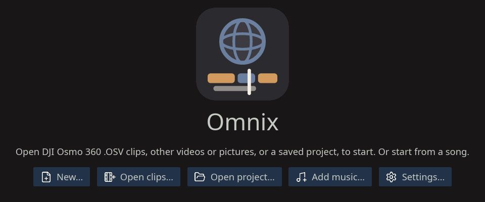

# Install and first run

Omnix and Dailix run on Linux. Omnix comes as a release (an archive with
an install script, or an AppImage); Dailix, for now, is built from its
source beside Omnix's.

## What you need

- **A graphics card with Vulkan** and up-to-date drivers: Omnix plays,
  decodes and exports on it.
- **ffmpeg and ffprobe** on your `PATH`. On Debian or Ubuntu:
  `sudo apt install ffmpeg`.
- **ALSA** for sound (PipeWire and PulseAudio work through it).
- To build: **Rust** 1.88 or newer ([rustup.rs](https://rustup.rs)), and
  on Debian or Ubuntu `sudo apt install pkg-config libasound2-dev`.

## Install Omnix from a release

*The first release is being prepared; until it's out, build it as
below.*

- **The archive**: unpack it and run `./install.sh`. It puts `omnix` in
  `~/.local/bin`, with its icon and a menu entry (`--prefix /usr/local`
  as root installs it for everyone; `--uninstall` takes it away).
- **The AppImage**: make it executable (`chmod +x`) and run it.

## Build both from source

The two live in two repositories, cloned side by side; Dailix builds
against Omnix's folder, which has to be named `omnix-360-studio`.

```sh
git clone https://github.com/nedcrest/omnix-360-studio
git clone https://github.com/nedcrest/dailix
cd omnix-360-studio && cargo build --release && cd ..
cd dailix && cargo build --release && cd ..
```

The programs are `omnix-360-studio/target/release/omnix` and
`dailix/target/release/dailix`. To put each in your menu, with its icon:

```sh
omnix-360-studio/target/release/omnix install
dailix/target/release/dailix install
```

Each finds the other by itself: on your `PATH`, or as a build in the
repository beside its own. (`OMNIX_BIN` and `DAILIX_BIN` name one
somewhere else.)

## Dailix's first run

Dailix asks where to keep your footage, in three folders:

- **Trips**: a folder for each trip, with its clips, its marking and its
  edits. This is the one Dailix needs.
- **TMP** (optional): where footage lands first, from cards and phones.
- **Sources** (optional): the originals, kept as they came off the
  camera and never changed.


1. To keep a folder somewhere else, select **Choose…** beside it.
2. Select **Use these folders**. Dailix makes the ones that aren't
   there yet.

You can change them later, in **☰** > **Settings** (or **Ctrl+,**).
Then select **+ New trip** to make your first trip, and **⋯** > **Add
videos…** on its page to bring your clips in. The
[tutorial](tutorial-1-dailix.md) goes on from there.

## Omnix's first run

Omnix opens on its start screen. Once you've made edits, they are shown
here as cards, the latest first.



- **New…**: an edit in a trip (the trip's clips in its bin), a new
  trip, or an edit on its own.
- **Open clips…**: videos, pictures or Osmo 360 clips, straight into a
  new edit.
- **Open project…**: an edit saved before.
- **Add music…**: start from a song, and cut the pictures to it.

An edit made in Dailix (its **→ Omnix**) opens in Omnix by itself.
