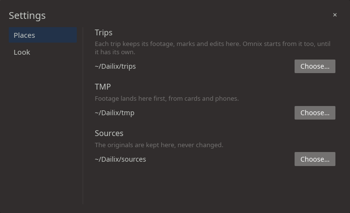
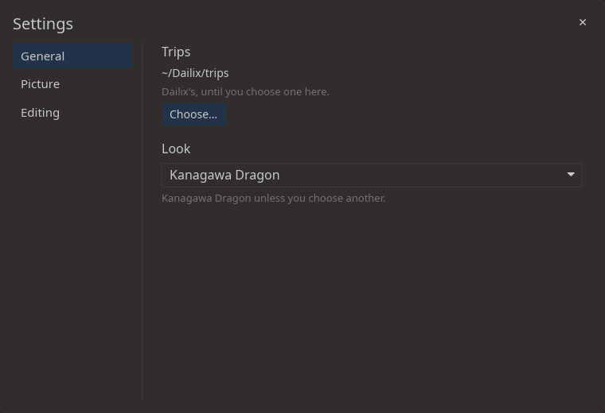

# Settings and files

## Dailix's settings

**☰** > **Settings** (or **Ctrl+,**).

| Group | Setting | What it does | At first |
|---|---|---|---|
| Places | **Trips** | Each trip's folder: its footage, marks and edits. Omnix starts from it too, until it has its own. | not set: the welcome offers `~/Dailix/trips` |
| Places | **TMP** | Where footage lands first, from cards and phones. | not set (`~/Dailix/tmp` offered) |
| Places | **Sources** | The originals, kept as they came off the camera, never changed. | not set (`~/Dailix/sources` offered) |
| Look | **Text size** | The interface's size; also **Ctrl+=**, **Ctrl+−**, **Ctrl+0** anywhere. | 100 % |
| Look | **Animate the cards** | A card's frames change while the pointer is over it; off, it only lights up. | on |

They're kept in `~/.config/dailix/settings.json` (under `$XDG_CONFIG_HOME` if set), with where the window was left (the trip, the clip, the player's width). `dailix places` shows or sets the places from a terminal.

## Omnix's settings

The **Settings** button at the left of the top bar (or **Ctrl+,**).

| Group | Setting | What it does | At first |
|---|---|---|---|
| General | **Trips** | Where Omnix looks for trips. **Choose…** for one of its own, **Use Dailix's** to follow Dailix's again. | Dailix's |
| General | **Look** | The colour theme. | Kanagawa Dragon |
| Picture | **10-bit** | Decode Osmo 360 clips and 10-bit videos at 10 bits, not 8 (from the next clip or seek). | off |
| Picture | **Rolling shutter** | Straighten the bending of a camera that reads its sensor row by row, in playback and export. | on |
| Picture | **LUTs** | The library of colour looks (`.cube`): **Add LUT…** copies one in, ✕ takes it out. **For D-Log M clips**: the LUT a D-Log M clip gets when it's added. | none |
| Editing | **Large time ruler** | Off: a compact ruler. | on |
| Editing | **Animate project cards** | On the start screen; off, a card's frames move only with the pointer. | on |
| Editing | **Auto keyframe** | Looking around a 360 clip while paused sets the view's keyframe at the playhead, as **K** does. | off |
| Editing | **Show the view as numbers** | A strip under the play row with the view's angles and field of view, to type in. | on |

They're kept in `~/.config/omnix/settings.json`, with what the window remembers by itself: the text size (**A−**, **A+** in the top bar), the export's last choices, the volume, which lanes and panels are folded, the recent edits.

## A trip's folder

Dailix makes a trip with this layout; both programs read and write it. Make a trip with Dailix (**+ New trip**) rather than by hand.

| Folder or file | What it holds | Written by |
|---|---|---|
| `01_footage/<day>/` | The clips, copied in from the originals | Dailix (**Add videos…**, `dailix add`) |
| `02_audio/music/` | Songs | you; Omnix's bin lists them |
| `02_audio/voiceover/` | Voice-overs | Omnix's recorder, or you |
| `06_external/` | Video from elsewhere (memes, inserts) | you; Omnix's bin lists it |
| `07_sfx/` | Sound effects | you; Omnix's bin lists them |
| `08_pictures/` | Pictures to put over the video | you; Omnix's bin lists them |
| `09_luts/` | The trip's own colour looks (`.cube`) | you |
| `LICENSES.md` in the four above | A line per file: where it came from, its licence, whether it needs credit | you |
| `dailix/project.json` | The trip's name, description and tags | Dailix |
| `dailix/sheet.json` | The marking: ratings, segments, flags, notes, the days' stories | Dailix and Omnix |
| `dailix/analysis/`, `dailix/thumbs/`, `dailix/voice/`, `dailix/cards/` | What Dailix knows of each clip, its poster, its cleaned voices; the edits' card frames | Dailix, Omnix |
| `videos/<edit>/edit.json` | An edit | Omnix |
| `videos/<edit>/export/` | Its exports | Omnix |

The originals stay in **Sources**, never changed; a trip holds copies.

## An edit's file

`edit.json` is plain JSON, open for scripts and for AI agents: Omnix's
command line reads and changes it the way the window does (`omnix
describe`, `omnix apply`, `omnix ops-schema`; see
[Commands: Omnix](commands-omnix.md)). An edit saved by an older Omnix
opens and looks as it did; one saved by a newer Omnix may not open in an
older one.

## Omnix's other folders

| Where | What |
|---|---|
| `~/.cache/omnix/` | The clip cache: telemetry, thumbnails, waveforms, quick copies for smooth playback. It makes a clip open at once after the first time. `omnix cache` says how big it is; `omnix cache move <folder>` puts it elsewhere; `omnix cache clear` empties it. |
| `~/.config/omnix/transitions/` | Saved transition templates. |
| `~/.config/omnix/luts/` | The LUT library (**Add LUT…**). |

Fonts for titles are built in (Inter, Bebas Neue, Caveat, Montserrat, Permanent Marker, Playfair Display), with your system's fonts beside them.
