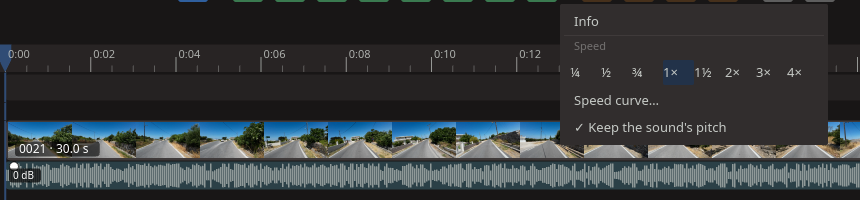
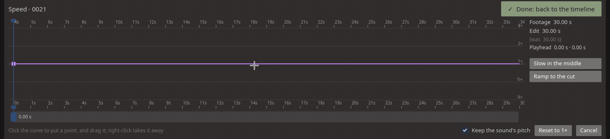
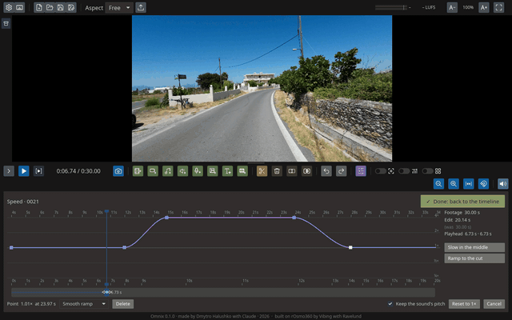

# Change a clip's speed

Slow a clip down, speed it up, or let its speed change as it plays:
the interesting stretch of a ride at normal speed, a dull lane at four
times, and back to normal for the view at its end. Its sound plays at
the same speed, keeping its pitch or, if you choose, like a tape.

## One speed for a whole clip

1. On the timeline, right-click a clip on **Video**.
2. Under **Speed**, select a step: **¼** to **4×**. **1×** is normal
   speed again.

The clip gets shorter or longer on the timeline, and the clips after it
move. Its label says how fast: «0021 · 15.0 s · 2×». To hear its sound
like a tape (slower is lower), clear **Keep the sound's pitch** in the
same menu.

## A speed that changes: the speed curve

1. On the timeline, right-click the clip, and select **Speed curve…**.
   The curve opens in the timeline's place; the picture above stays.
2. Select the curve where the speed should start changing: a point is
   put there. Drag it where you want it.
3. Put the other points: up is faster (to **4×** at the top), down is
   slower (to **¼×** at the bottom). Between two points the speed
   eases from one to the other.
4. Press **Space** to play the clip at the curve's speed; press it
   again to pause.
5. Select **✓ Done: back to the timeline**. **Ctrl+Z** takes it all
   back in one step.

The ride below runs at normal speed for its first eight seconds, rises
to four times through a dull stretch, and eases back to normal by its
24th second. The clip that lasted 30 seconds now lasts 20.

Playing it, the window's playhead follows the picture, and the road
rushes past where the curve is high.

### Reading the curve

- **Across** is the clip's own time. The ruler above the curve counts
  its seconds; the ruler below counts the seconds on the edit, close
  together where the clip is sped up and far apart where it's slowed.
- **The strip at the bottom** is the window's playhead: select or drag
  anywhere on it, and the picture shows that moment. **Home** and
  **End** take it to the start and the end, **←** and **→** a frame at
  a time.
- **A point**: select it to see its speed and where it is. Under the
  curve, choose how it goes on to the next point: **Step to the next**
  (the speed jumps there), **Even ramp** or **Smooth ramp**. Right-click
  a point, or press **Delete**, to take it away.
- **At the right**: the clip's length, its length on the edit now and
  before, and the playhead. **Slow in the middle** and **Ramp to the
  cut** put ready-made curves; **Reset to 1×** clears it.

### Several clips at once

To give several clips one curve, select them side by side on the
timeline (select the first, then Shift-select each of the others), and
open **Speed curve…** on one of them. The curve runs across all of them, a
line at each join; **Done** gives each clip its part.

**Cancel** or **Esc** closes the window and leaves the clips as they
were, even if you played them at the new speed.

## Good to know

- The clip's keyframes, markers and volume points stay on the same
  moments of the footage: at twice the speed they come twice as soon.
  Crossfades, fades and the length of an edge look are times on the
  edit, so they stay as long.
- A clip whose sound runs past its picture (a J or L cut) can't change
  speed yet: right-click its sound on **Clip sound**, and select
  **Sound back to the picture's edges** first.
- From a clip filmed at 100 frames a second, a slowed stretch repeats
  frames in the export for now, as one filmed at 30 does.
