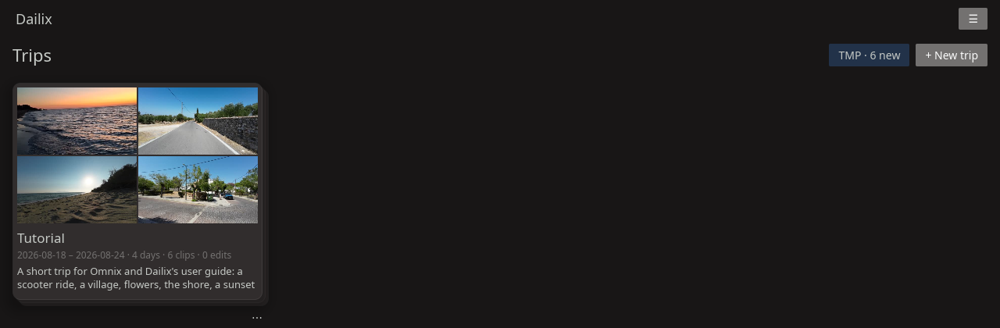
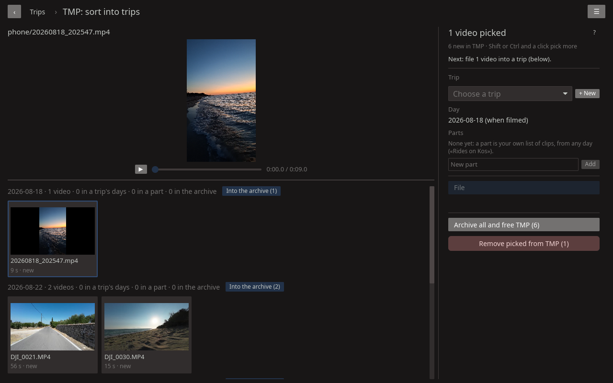
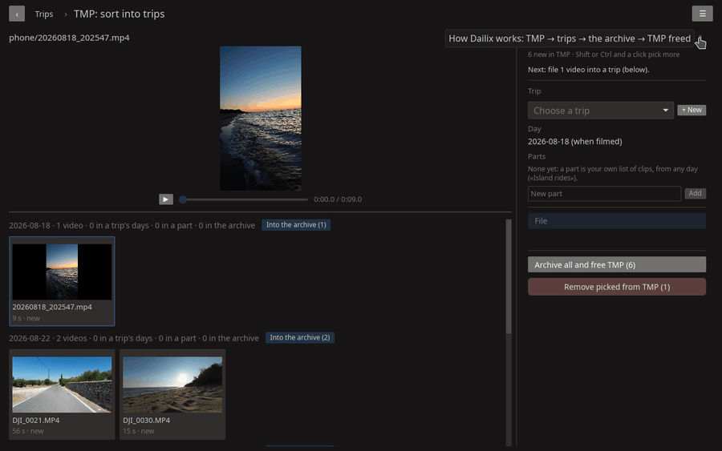
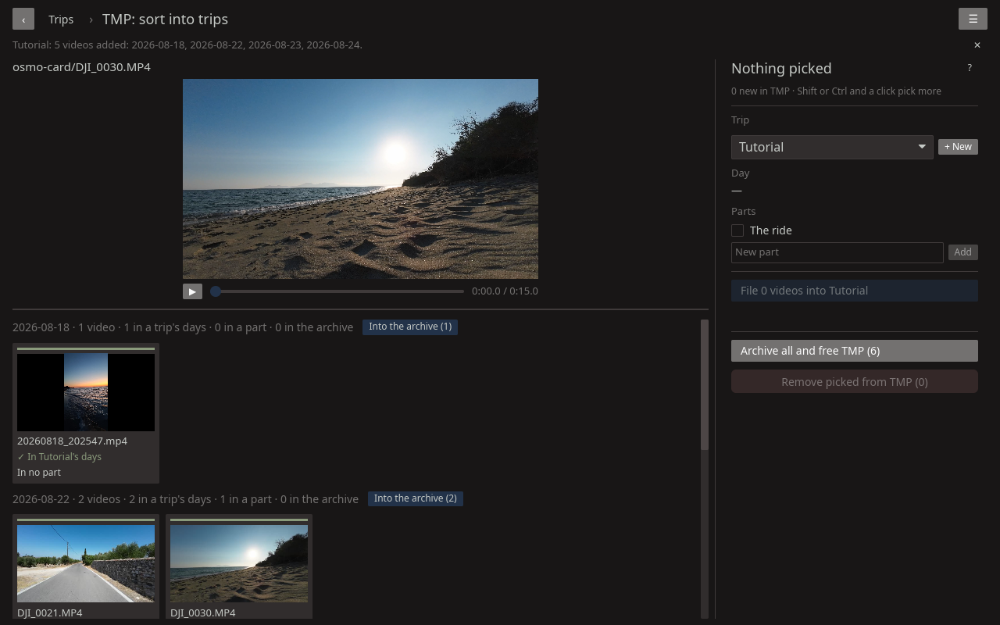
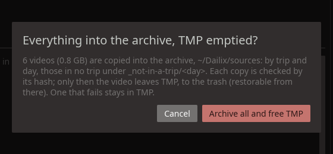
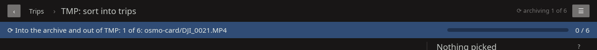
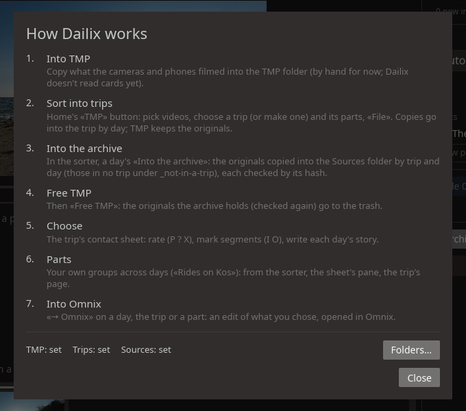

# Bring the footage in

In this part the videos you filmed go from a card and a phone into a
trip: sorted by the day they were filmed, some of them into a part of
the trip, and the originals kept safe in the archive before TMP lets
them go. It takes about five minutes.

You need Dailix with its three folders set (its welcome asks for them
on the first run): **TMP**, where footage lands first; **Trips**; and
**Sources**, the archive of originals. The pictures show six clips from
a short trip: a scooter ride, a village, flowers, the shore and a
sunset.

## Put the videos into TMP

Copy what the cameras and the phone filmed into the TMP folder, a
folder each if you like (`osmo-card`, `phone`). Dailix doesn't read
cards itself yet.

Dailix's **Trips** page now has a **TMP** button saying how many videos
there are new.

1. Select **TMP · 6 new**.

The sorter opens. TMP's videos are tiles, day by day, by the day each
was filmed: the date in its name, else the date the camera wrote in it.
A video with neither shows under **No date**. The picked one plays
above the tiles; drag the line between them to make the player bigger.

## Sort them into a trip

To pick a video, select its tile; **Ctrl** and a click add one more,
**Shift** and a click the run between; **Ctrl+A** picks every new one.
**←** and **→** go from tile to tile.

2. Select the tile of the ride along the road.
3. Next to **Trip**, select **+ New**, type **Tutorial**, and press
   **Enter**. The trip is made and chosen; its folder is named by the
   month the videos were filmed.
4. Under **Parts**, type **The ride** and select **Add**. A part is a
   group of your own, from any days of the trip: the scooter videos of
   every day, say. It's ticked for the videos you file now.
5. Select **File 1 video into Tutorial**.

The video is copied into the trip, under its day; TMP keeps the
original. Its tile says where it went, on two lines: **In Tutorial's
days**, and its part (or **In no part**).

6. Press **Ctrl+A** to pick the other five, clear **The ride**, and
   select **File 5 videos into Tutorial**.

While it copies, a blue bar under the top says how far it is.

## Keep the originals in the archive

Each day's line says how many of its videos are in a trip, in a part
and in the archive, and offers the next step:

- **Into the archive** copies the day's originals into **Sources**, by
  trip and day (those in no trip yet under `_not-in-a-trip/<day>`), and
  checks each copy by reading it back.
- **Free TMP** then sends the originals the archive holds to the trash,
  each archive copy checked again first.

For all of TMP at once:

7. Select **Archive all and free TMP** at the bottom of the panel.

8. Select **Archive all and free TMP**.

A video goes to the trash only once its copy in the archive is checked;
one that fails stays in TMP and Dailix says why. Nothing in the archive
is ever written over.

TMP is empty again; the trip holds its copies, the archive the
originals.

## Good to know

- **Remove picked from TMP** (under **Archive all**) sends the picked
  videos to the trash without archiving them, after asking; it says in
  red which of them aren't in the archive.
- A part can be filled later too: in the trip's contact sheet, pick
  clips with **Ctrl** or **Shift** and a click, then **Into part…**.
- A video archived under `_not-in-a-trip` and filed later: its archive
  copy follows it into the trip's day.
- **?** in the sorter, or **How Dailix works** in **☰**, shows the whole
  way in seven steps and whether the three folders are set.

Next: [Choose in Dailix](tutorial-1-dailix.md), on the trip you just
made.
