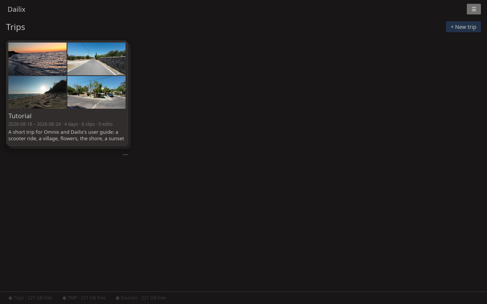
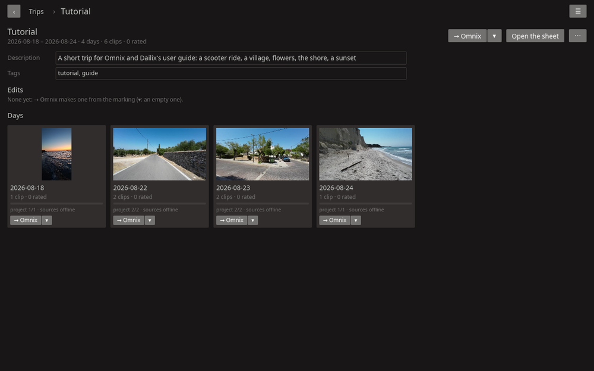
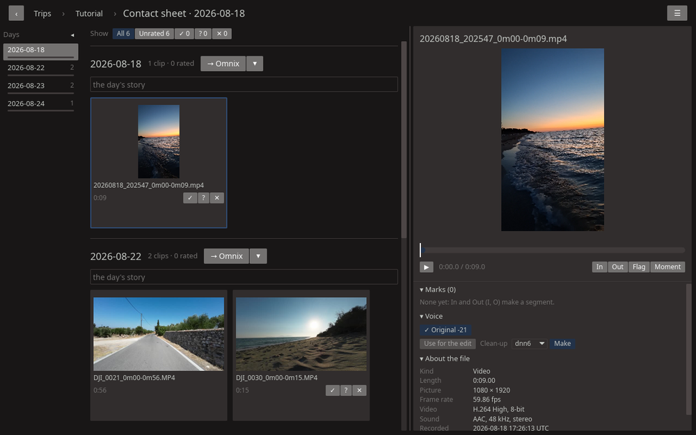
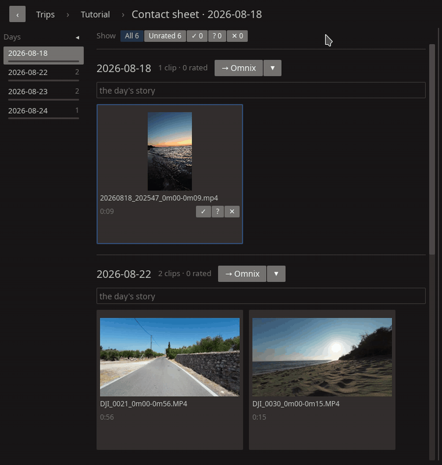
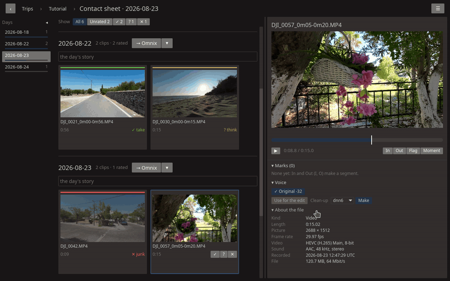

# Choose in Dailix

In this part you look through a trip's clips, rate them, mark the
stretch of one clip you want, and send what you chose to Omnix as a
first edit. It takes about ten minutes.

You need Dailix with its three folders set (its welcome asks for them
on the first run) and a trip with a few clips. The pictures show a trip
called **Tutorial**: six short clips over four days.

## Open the trip

Dailix opens on **Trips**, a card for each trip. A card shows four of
the trip's frames; with the pointer over it, they change.

1. On **Trips**, select the **Tutorial** card.

The trip's page opens: its dates and counts, its description and tags,
the edits made from it so far (none yet) and a card for each day.

2. Select **Open the sheet**. (A day's card opens the sheet at that
   day.)

## Look through the clips

The contact sheet shows every clip of the trip as a tile, day by day.
The days are listed on the left: select one to jump to it. The clip you
pick plays in the player on the right.

To pick a clip, select its tile, or move from tile to tile with **←**
and **→**. **Space** plays and pauses.

## Rate them

Every clip gets one of three ratings:

| Key | Rating | Means |
|---|---|---|
| **P** | ✓ take | it goes into the edit |
| **?** (the **/** key, no Shift) | ? think about it | it goes in too, to decide in the edit |
| **X** | ✕ junk | it stays out |
| **U** | unrated | not looked at yet: it stays out too |

1. Pick the first clip.
2. Press **P**, **?** or **X**. The clip takes the rating and the next
   clip is picked, so you can go through a day with one key a clip.
3. Rate every clip but one, say the flowers.
4. Above the tiles, select **Unrated** to see only what's left.

The tile shows its rating as a line of colour along its top: green for
a take, amber for think about it, red for junk (and the poster dimmed).
On the tile you have picked, ✓, ? and ✕ do the same as the keys; select
the lit one again to make the clip unrated. The animation shows four
clips rated and then the unrated ones alone.

Select **All** to see every clip again.

## Mark the stretch you want

A clip rated ✓ or ? goes into the edit whole, unless you mark the
stretch of it you want: a **segment**. Here you keep eight seconds of
the flowers.

1. Pick the flowers clip.
2. On the strip under the picture, select the place where the stretch
   starts (about 0:03), then select **In** (or press **I**).
3. Select the place where it ends (about 0:11), then select **Out** (or
   press **O**). The segment appears on the strip, and Dailix asks for
   its role.
4. Choose a role with **↑**, **↓** and **Enter**, or select it: here
   **B-roll**, footage that shows the place.
5. Type a note, *flowers in the shade*, and press **Enter**.
6. Press **P**: the clip is a take, so its segment goes into the edit.

The segment is listed under **Marks** beside the player, with its time,
role and note; select it to change them, or press **Delete** to remove
it. **Esc** takes away a segment you have only just made. Beside **In**
and **Out**, **Flag** (**M**) leaves a note to yourself at a moment, and
**Moment** (**N**) marks a second either side of it as a segment.

Above each day's tiles you can write **the day's story**: what
happened that day. It is saved as you type.

## Send it to Omnix

1. In the top bar, select **Tutorial** to go back to the trip's page
   (or press **Alt+←**).
2. Select **→ Omnix**.

Dailix makes an edit from what you chose and opens it in Omnix: every
clip rated ✓ or ?, each whole or as its segments, day by day in the
order they were filmed. A segment's role and note go with it. The
junk and the unrated clips stay out.

The edit is listed under **Edits** on the trip's page from now on.
Select **→ Omnix** again later and Dailix offers to open it rather than
make another. The **▾** beside it makes an empty edit instead, with
every clip in Omnix's bin to build from, or an edit of one day only.

Next: [edit in Omnix](tutorial-2-omnix.md).
