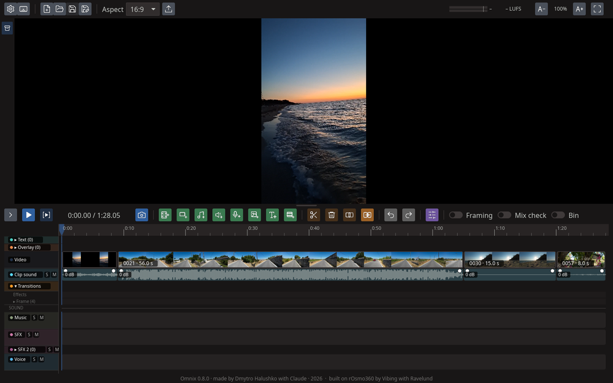
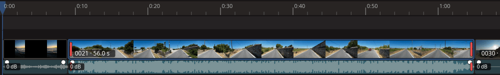
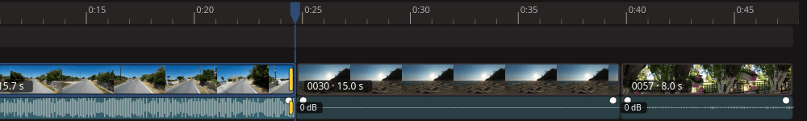
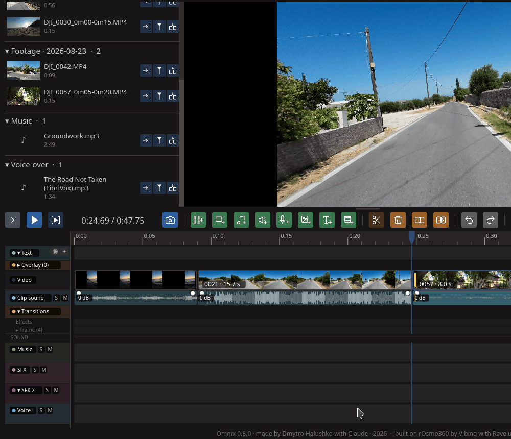
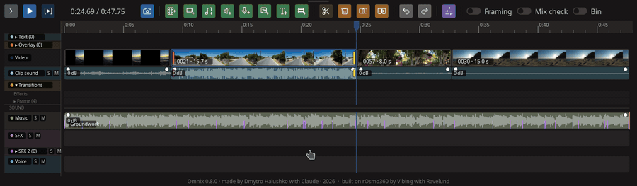
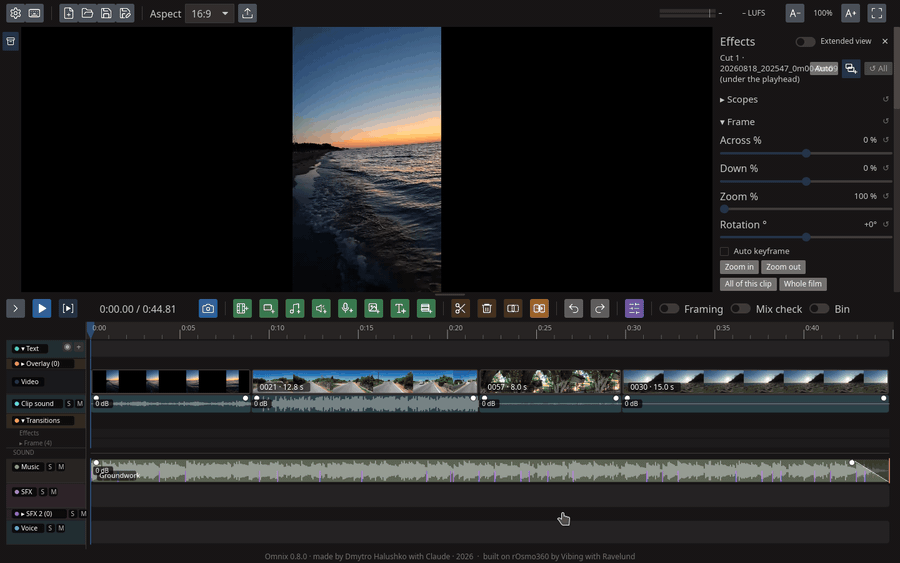
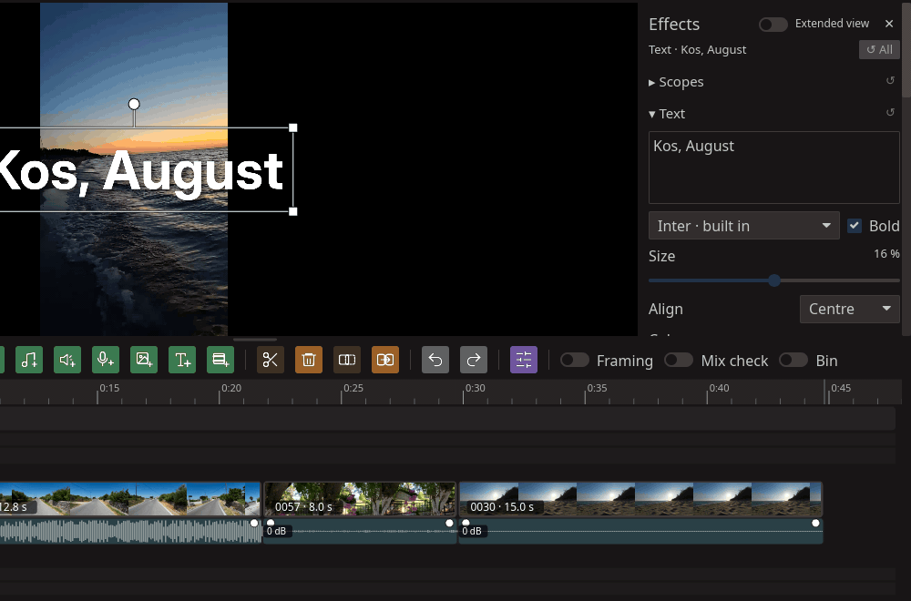
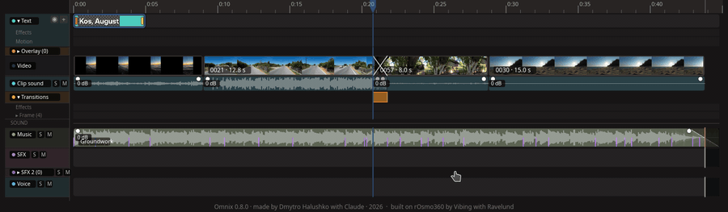
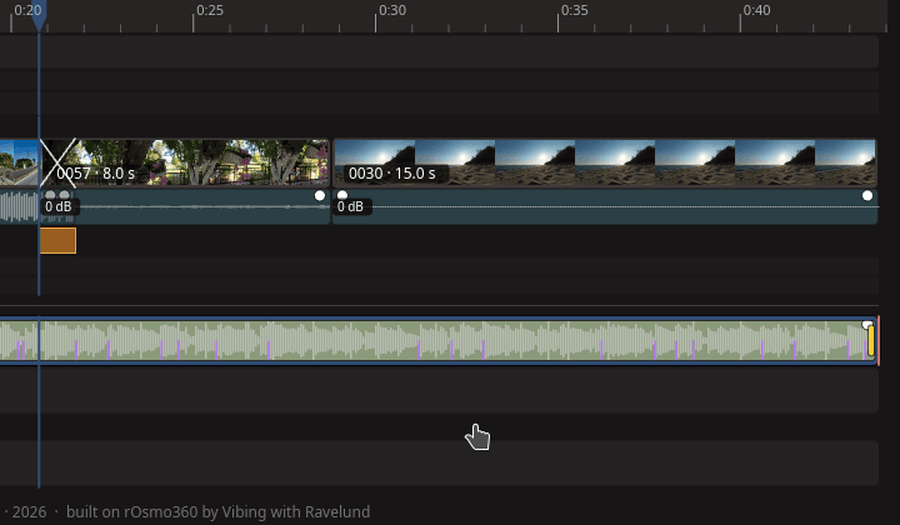
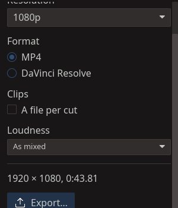

# 2. Edit in Omnix

In this part you turn the edit Dailix made into a short film: shorten a
clip, change the order, put a song under it and cut on its beats, add a
title and a transition, fade the song out and export. It takes about
fifteen minutes. The song, the title and the transition here are
examples of each kind of step; your own film can use as many or as few
as you like.

## The window

After **→ Omnix** in part 1, Omnix opens with the edit: the clips you
rated, in the order they were filmed, the flowers as their eight-second
segment.

- **The top bar**: settings and keys; new, open, save; the shape of the
  film (**Aspect**) and export; the sound meter; the text size.
- **The picture**: the film at the playhead. The **Bin** opens at its
  left, panels (Effects, Transitions, Export…) at its right.
- **The row under the picture**: play, then buttons to add things at
  the playhead (clips, music, sound, a voice, pictures, text), then
  split, delete and the transitions, undo and redo, and the switches
  (**Framing**, **Mix check**, **Bin**). The buttons show icons; hold
  the pointer over one to read what it does, or select **›** at the
  row's start to show the groups' names.
- **The timeline**: the ruler, then the lanes: **Text** and **Overlay**
  over the picture, **Video** (the clips), **Clip sound** (their own
  sound), **Transitions**, and the sound lanes **Music**, **SFX**,
  **SFX 2** and **Voice**.

**Space** plays and pauses; select the ruler to move the playhead.
**F1** lists every key.

## Shorten a clip

The scooter ride is 56 seconds; keep the first fifteen.

1. On the **Video** lane, select the scooter clip. Its ends get handles.
2. Drag its right handle to the left, to about 15 seconds.

The clips after it move up to close the gap. A yellow handle means the
clip has more footage past it, a red one that it's at the clip's end.
With the keys: put the playhead where the clip should end and press
**Alt+]** (**Alt+[** for its start). **C** splits a clip at the
playhead; **Del** deletes the selected one.

## Change the order

Put the flowers before the beach.

1. Select the flowers clip.
2. Press **Alt+←** to move it one place left (**Alt+→** to the right).
   Or drag it to its new place.

## Add a song

1. Select **Bin** at the picture's left edge (or press **B**). The bin
   lists the trip's footage, music and voice-overs.
2. Under **Music**, beside the song, select the first button, **Add on
   the Music lane after its last sound**.

The song lands on the **Music** lane at the start of the film. It is
longer than the film; you trim it at the end of this part. Music you
use in a film you share has to allow it; the song here does, credited
as its author asks: "Groundwork" Kevin MacLeod (incompetech.com),
Licensed under Creative Commons: By Attribution 4.0 License.

## Cut on the beats

Omnix finds a song's beats, and a clip's ends snap to them.

1. Right-click the song and select **Show the beats**. They appear as
   purple marks on the song.
2. Right-click it again and select **Snap to the beats**.
3. Select the scooter clip and drag its right handle a little. It
   lands on the beats, shown by a yellow line.

The slider in the same menu sets which beats count: lower, every beat;
higher, the strong hits only. If nothing snaps, snapping is off: press
**N**.

## Add a title

1. Press **Home** to bring the playhead to the start.
2. In the row under the picture, select **Add text over the picture, at
   the playhead** (the **T** with a plus).
3. In the **Effects** panel that opens, under **Text**, select the text
   and type the title: *Kos, August*.
4. Drag **Size** to make it larger.

The title sits on the **Text** lane: drag it to move it in time, drag
its ends to show it longer. In the picture, drag its box to place it.
The **Effects** panel has its font, colour, shadow and outline, and how
it appears and goes.

## Add a transition

1. Select the ruler at the join between the scooter and the flowers, to
   put the playhead there.
2. Press **T** (or select **Transitions** in the row under the picture).
   The **Transitions** panel opens at the join nearest the playhead.
3. Under **Camera moves**, select **Whip pan**.
4. Next to **Length**, select **+** twice, to 1 second.

The join shows a mark on the **Transitions** lane. Beside the panel,
the look's own settings (here its direction). **◀ Previous** and **Next
▶** go to the other joins; a length with no look is a plain dissolve.
A transition overlaps the two clips, so the film is that much shorter.

## Fade the song out

The song still runs past the film's end.

1. Right-click the **Music** lane's name, at the left, and select
   **Trim to the film's end**.
2. Drag the small circle at the song's top right corner to the left: the
   song now fades out over the last seconds.

## Export and save

1. Press **Ctrl+E** (or select **Export** in the top bar).
2. In the **Export** panel, choose the **Resolution** (1080p is a good
   start) and, for a film you'll put online, a **Loudness** target (for
   YouTube and most phones, -14 LUFS).
3. Select **Export…**, then **Save** in the dialog.

The file goes into the edit's own folder in the trip
(`videos/<edit>/export/`) unless you choose another place. The top bar
shows how far the export has got, with a button to stop it.

Press **Ctrl+S** to save the edit. It is saved where Dailix made it, in
the trip; open it again from the trip's page in Dailix, or with
**Ctrl+Shift+O** in Omnix.

That's the whole way from a card full of clips to a film. The how-to
pages take each step further.
